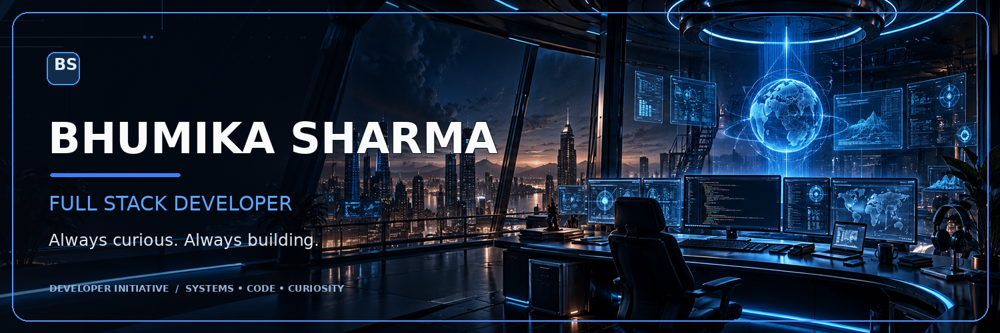

  

  

## About

I'm a BCA student who enjoys building web applications, working across the stack, and figuring out how things fit together behind the scenes.

I like learning by building. Lately, I've been spending more time on backend development, databases, system design, and the tools that help applications run reliably.

## ⚡ Technology Arsenal

  

  
  
  
  
  
  
  
  

  
  
  
  
  
  
  
  

## Current Missions

- Exploring **system design** and how to build reliable, scalable applications.
- Strengthening **backend engineering** and REST API design.
- Practising with **Docker**, containers, and development workflows.
- Improving problem-solving through **DSA**.
- Building with **React**, **Node.js**, and **TypeScript**.

## GitHub Performance

  
  

  

## Establish Connection

  
  <!-- Add your LinkedIn and portfolio links here when ready. -->

  <strong>Always curious. Always building.</strong>

